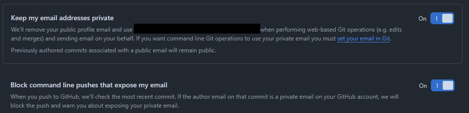

# El email de tu Git es público

Cuando trabajas con Git, uno de los pasos de configuración es colocar el email con el que vas a hacer el commit con el siguiente comando:

```Bash
git config --global user.email <your_github_email>
```

Puedes configurarlo tanto de forma global como de forma local (por repositorio), el ejemplo anterior es con configuración de forma global. El propósito de ello es saber quién hizo el commit.

Técnicamente puedes colocar cualquier correo, pero para que pueda ser verificado dentro de GitHub, éste debe ser el mismo que usas para loguearte en la plataforma.

# ¿Cuál es el problema?

Cada vez que mandas un commit a GitHub, estén firmados o no, el correo del autor queda guardado en los commits a los que figura como su autor. Los cuales se pueden ver al consultar el log del repostorio al que se tenga acceso, como por ejemplo los repositorios públicos.

Validar eso es bastante sencillo, una opción es descargarte el repositorio público y ejecutar:

```Bash
git log
```

La otra opción es dirigirte a un commit en específico en un repositorio dentro de GitHub y al final de la URL agregar `.patch`.

En ambos casos, al principio del mensaje puedes ver quién lo ha firmado y con qué correo.

# Pasos para ofuscar nuestro correo en commits

En 2017 GitHub implementó [Private emails](https://github.blog/news-insights/product-news/private-emails-now-more-private), una opción para firmar tus commits con otro correo que no sea el de tu cuenta de GitHub, pero manteniendo las mismas funcionalidades incluyendo la firma de los commits.

El primer paso es buscar el correo que GitHub te ha asignado, para ello en tu cuenta de GitHub sigue esta dirección: `settings -> Emails`

Al final encontrarás estas dos opciones:



Al habilitar la primera opción hace que el correo que aparece allí se pueda usar en commits y también para firmarlos.

Con la segunda opción habilitada, GitHub bloqueará todos aquellos commits que vengan firmados con el correo que usas para loguearte en GitHub.

# ¿Cómo implementarlo?

El proceso es bastante sencillo, una vez habilitada las opciones anteriores debes volver a configurar tu Git con el nuevo correo. Por ejemplo, para los commits de forma global:

```Bash
git config --global user.email <your_github_private_email>
```

Y para la firma con GPG, solo necesitas seguir los mismos pasos pero con el nuevo correo. Dejo por acá la documentación: [Managing commit signature verification](https://docs.github.com/en/authentication/managing-commit-signature-verification).

# ¿Por qué esto es importante?

Agrega una capa de seguridad adicional a tu cuenta de GitHub y al correo al que está asociado disminuyendo un vector de ataque al no estar expuesto de forma pública.

::: {.callout-important}

Ten en cuenta que los commits ya firmados siguen teniendo el correo anterior con el que venías firmando, así que puedes sobreescribir la historia de esos repositorios o bien volverlos privados. Hay diferentes opciones, selecciona la que mejor se adapta a tu flujo actual de trabajo.
:::

Adicional a ello, activa 2FA y usa siempre contraseña robustas.
